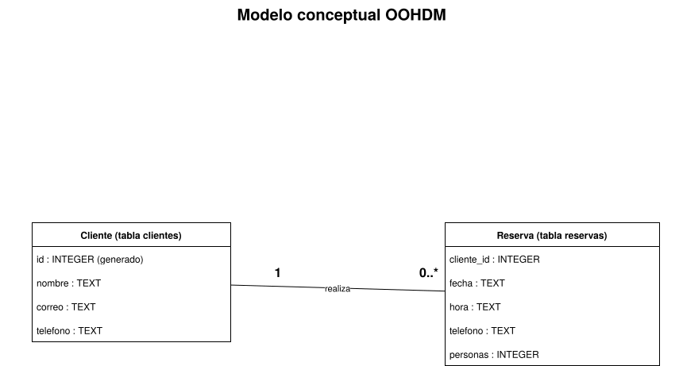
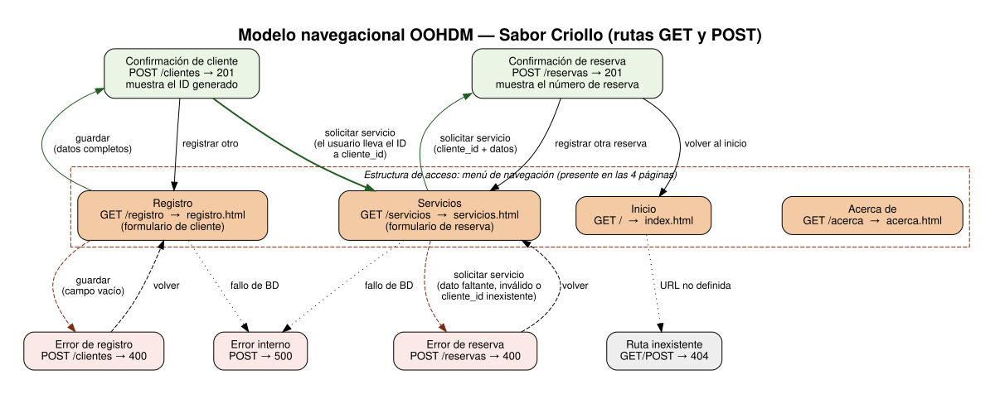
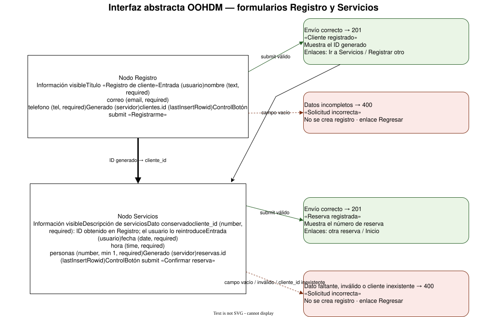
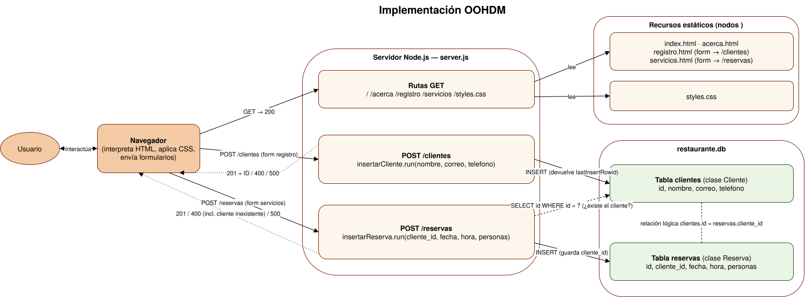

# Documentación OOHDM

**Autor:** Cristian Barrientos Torres · **Asignatura:** Ingeniería Web · **Temática:** Restaurante

Este documento aplica la metodología **OOHDM** (Object-Oriented Hypermedia Design Method) a la plataforma
implementada en la práctica del 20 %. Los nombres de rutas, formularios, tablas y campos son los reales del repositorio
(`server.js`, `registro.html`, `servicios.html`). Los fuentes editables están en [`fuentes/`](fuentes/): archivos `.drawio` (abrir en diagrams.net / draw.io) y los `.dot` de Graphviz con los que se generaron las imágenes.

---

## 1. Diseño conceptual

_¿Qué información maneja la plataforma y cómo se relaciona?_

**Reglas del dominio.** Un **Cliente** (`id`, `nombre`, `correo`, `telefono`) es la entidad principal: su `id` lo genera el
sistema al registrarlo. Una **Reserva** (`id`, `cliente_id`, `fecha`, `hora`, `personas`) siempre pertenece a un único cliente,
mientras que un cliente puede tener cero o muchas reservas (multiplicidad 1 a 0..\*). La reserva no repite los datos
personales del cliente; solo guarda la referencia `cliente_id`. Todos los atributos son obligatorios y `personas` es un entero mayor que cero.

## 2. Diseño navegacional

_¿Qué nodos visita el usuario y cómo se desplaza entre ellos?_

- **Nodos:** Inicio (`GET /`), Acerca de (`GET /acerca`), Registro (`GET /registro`), Servicios (`GET /servicios`) y las respuestas de
  `POST /clientes` y `POST /reservas` (201, 400, 500), más el 404 para rutas no definidas.
- **Estructura de acceso:** el menú (`nav`) presente en las cuatro páginas HTML permite ir a cualquiera de ellas.
- **Enlaces/acciones:** _guardar_ (envío del formulario de registro), _solicitar servicio_ (envío del formulario de reserva),
  _volver_, _registrar otro_ y _registrar otra reserva_.
- **Uso del identificador:** la confirmación de `POST /clientes` muestra el ID generado; el usuario lo lleva al campo `cliente_id`
  de Servicios. No hay sesión ni cookies: el ID viaja únicamente porque el usuario lo reescribe.

## 3. Diseño de interfaz abstracta

_¿Qué información, controles y respuestas contiene cada nodo?_

- **Registro** (`#formulario-registro`, `POST /clientes`): el usuario escribe `nombre`, `correo` y `telefono`; el servidor genera `clientes.id`.
- **Servicios** (`#formulario-reserva`, `POST /reservas`): el usuario escribe `cliente_id` (dato conservado del registro), `fecha`, `hora` y
  `personas`; el servidor genera `reservas.id`.
- **Envío correcto:** respuesta 201 con el ID (cliente) o el número de reserva. **Datos incompletos** (o, en Servicios, un `cliente_id` que no existe): respuesta 400, sin crear registro.
- Este modelo no define colores ni tipografías; eso pertenece a la presentación visual (`styles.css`).

## 4. Implementación

_¿Cómo se materializan los modelos anteriores con tecnologías concretas?_

El navegador pide las páginas y `styles.css` por GET a `server.js` (módulo `http` de Node.js, puerto 3000). Los formularios envían POST a
`/clientes` y `/reservas`; el servidor interpreta el cuerpo con `URLSearchParams`, aplica `trim()`, valida y ejecuta INSERT preparados sobre
`restaurante.db` (`node:sqlite`, `DatabaseSync`). Clase **Cliente** → tabla `clientes`; clase **Reserva** → tabla `reservas`.
Antes de insertar una reserva, `buscarCliente` ejecuta `SELECT id FROM clientes WHERE id = ?` para verificar que el cliente exista; además se realizan los INSERT sobre ambas tablas.

## 5. Matriz de correspondencia

| Elemento OOHDM                 | Ruta o archivo                      | Tabla o campo                                                            | Evidencia funcional                                                          |
| ------------------------------ | ----------------------------------- | ------------------------------------------------------------------------ | ---------------------------------------------------------------------------- |
| Entidad principal (Cliente)    | `POST /clientes`                    | `clientes`: `id`, `nombre`, `correo`, `telefono`                         | Registro almacenado e ID generado (201)                                      |
| Operación o servicio (Reserva) | `POST /reservas`                    | `reservas`: `id`, `cliente_id`, `fecha`, `hora`, `personas`              | Operación asociada mediante `cliente_id` (201)                               |
| Nodo Inicio                    | `GET /` · `index.html`              | No aplica                                                                | Página presentada (200)                                                      |
| Nodo Acerca de                 | `GET /acerca` · `acerca.html`       | No aplica                                                                | Página presentada (200)                                                      |
| Nodo de registro               | `GET /registro` · `registro.html`   | No aplica                                                                | Formulario presentado                                                        |
| Nodo de servicios              | `GET /servicios` · `servicios.html` | No aplica                                                                | Formulario de reserva presentado                                             |
| Presentación visual            | `GET /styles.css` · `styles.css`    | No aplica                                                                | `Content-Type: text/css`, estilos aplicados                                  |
| Evento de envío (registro)     | `POST /clientes`                    | `INSERT INTO clientes (nombre, correo, telefono)` parametrizado          | Respuesta 201 con ID                                                         |
| Evento de envío (servicio)     | `POST /reservas`                    | `INSERT INTO reservas (cliente_id, fecha, hora, personas)` parametrizado | Respuesta 201 con número de reserva                                          |
| Datos incompletos              | `POST /clientes`, `POST /reservas`  | Sin inserción                                                            | Respuesta 400                                                                |
| Cliente inexistente            | `POST /reservas`                    | `SELECT id FROM clientes WHERE id = ?`                                   | Respuesta 400, sin crear reserva                                             |
| Ruta no definida               | cualquier otra URL                  | No aplica                                                                | Respuesta 404                                                                |
| Error interno                  | manejadores POST (`catch`)          | No aplica                                                                | Respuesta 500                                                                |
| Relación 1 a 0..\*             | `servicios.html` (`cliente_id`)     | `clientes.id` = `reservas.cliente_id`                                    | Reserva ligada a un cliente existente (validado por código, sin FOREIGN KEY) |
